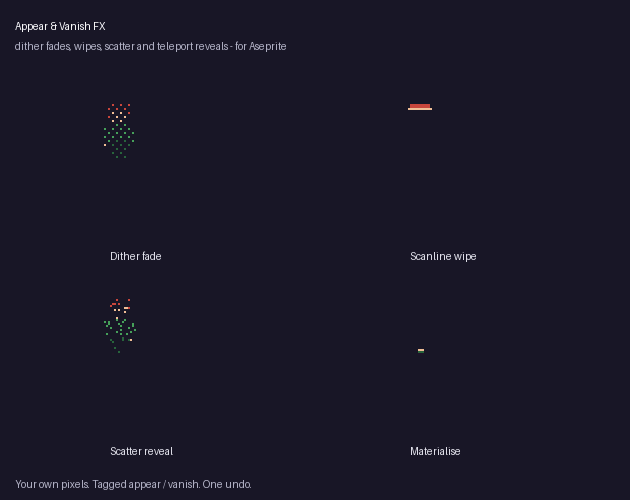

# Appear & Vanish FX Lite (free) for Aseprite

One click turns your sprite into a dither fade-in and fade-out: 6 frames each (Bayer 4x4), tagged `appear` and `vanish`.
Pixel-exact, palette-safe, one undo.

## Install
Double-click `appear-vanish-fx-lite.aseprite-extension`. Aseprite 1.3+.

## Use
Right-click the cel > Properties > **Appear & Vanish FX (Lite)...** or Edit > FX.

The full version adds Bayer 8x8, scanline wipes in four directions with an edge colour, seeded scatter reveals, a teleport
materialise, trails, frame count and all-layers mode: https://mst-9.itch.io/appear-vanish-fx
**Disclosure:** the code was written with an AI coding assistant; no image AI is involved.

## Licence
MIT (this Lite version). The full version is a separate paid product.
